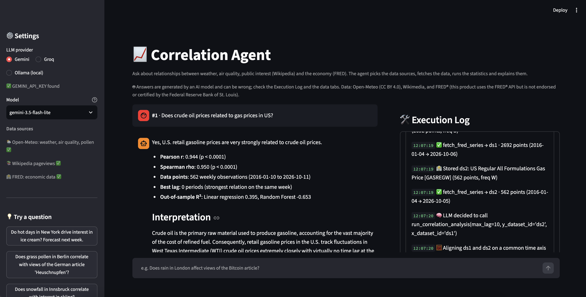
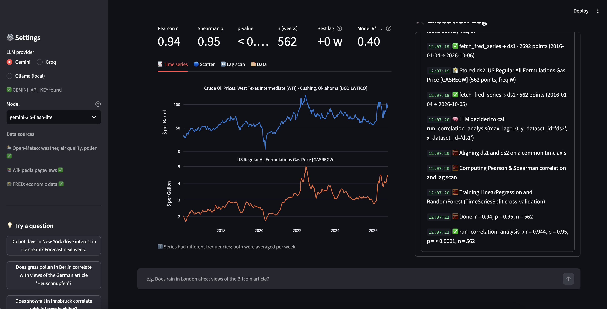
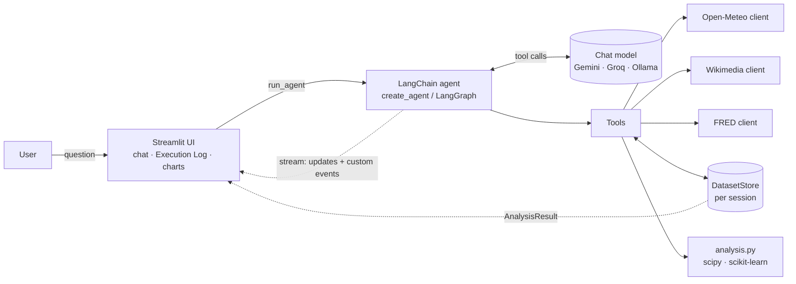
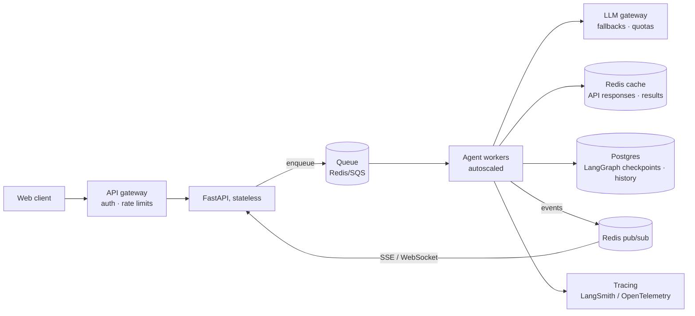

# 📈 Correlation Agent

A proof-of-concept dashboard where you ask a question in plain language, such as *"Do hot days in New York drive interest in ice cream? Forecast next week."*. An LLM agent then:

1. works out what the question means and which variables are involved,
2. **decides on its own** which open-data APIs to call and with which arguments,
3. fetches the data and lines it up on a common time axis,
4. runs statistics and trains small ML models on the fly (Pearson/Spearman correlation, a lag scan, linear regression and a random forest, plus an optional forecast),
5. explains the result in plain language. Interactive charts show the data, and a live **Execution Log** shows every step.

| Data source | What it provides | Key |
|---|---|---|
| [Open-Meteo](https://open-meteo.com) | Daily historical weather (ERA5), air quality & pollen, 16-day forecast for any city | none |
| [Wikimedia Pageviews](https://wikimedia.org/api/rest_v1/) | Daily views of any Wikipedia article in any language, a proxy for public interest | none |
| [FRED](https://fred.stlouisfed.org/docs/api/fred/) | 800k+ US economic/financial series (VIX, CPI, unemployment, rates, prices…) | free, optional |

---

## Screenshots

**Question and answer.** The agent's explanation is on the left. The live **Execution Log** on the right shows every LLM decision, API call and model-training step.



**Results.** Metric tiles (Pearson r, Spearman ρ, p-value, n, best lag, out-of-sample R²) and interactive charts: time series, scatter, lag scan, forecast, and the raw data.



---

## Quick start

```bash
cp .env.example .env          # add GEMINI_API_KEY and/or GROQ_API_KEY (both free), optionally FRED_API_KEY
```

**Conda**
```bash
conda create -n insdrone python=3.12 -y && conda activate insdrone
pip install -r requirements.txt
streamlit run app.py
```

**venv**
```bash
python3.12 -m venv .venv && source .venv/bin/activate
pip install -r requirements.txt
streamlit run app.py
```

**Docker**
```bash
docker build -t corr-agent .
docker run -p 8501:8501 --env-file .env corr-agent      # → http://localhost:8501
```
> **Write the keys in `.env` without quotes** (`GEMINI_API_KEY=abc…`, not `"abc…"`). Docker's `--env-file` passes values literally, so quotes would become part of the key and the provider rejects it. Running without Docker strips quotes, so this only shows up in the container.

**Local LLM instead of Gemini:** install [Ollama](https://ollama.com), run `ollama pull qwen2.5:7b` and choose *Ollama* in the sidebar. Docker reaches the host's Ollama through `host.docker.internal`.

**CLI (no UI):**
```bash
python -m corr_agent.agent "Does snowfall in Innsbruck correlate with interest in skiing?" --provider gemini
```

**Tests:** `pytest`. They cover the API clients with mocked HTTP, the analysis on synthetic data, and the tools with stubbed clients.

### Example questions
- Do hot days in New York drive interest in ice cream? Forecast next week.
- Does grass pollen in Berlin correlate with views of the German article "Heuschnupfen"?
- Is PM2.5 pollution in Delhi related to interest in asthma?
- Does market fear (VIX) drive interest in "Recession"? *(FRED)*
- Is US unemployment correlated with views of "Unemployment benefits"? *(FRED, monthly)*
- Does rain in London affect views of the Bitcoin article? *(should come out close to zero)*

---

## Architecture



```
app.py                     Streamlit UI (chat, live Execution Log, charts)
corr_agent/
  agent.py                 create_agent + streaming → AgentEvent; CLI entry point
  tools.py                 LangChain tools (pydantic schemas) bound to a DatasetStore
  prompts.py               system prompt (procedure for the agent)
  llm.py                   provider factory: Gemini | Groq | Ollama → BaseChatModel
  analysis.py              alignment, correlation, lag scan, regression, forecast (pure, no I/O)
  charts.py                Plotly figures
  data_store.py            per-session datasets addressed by id
  clients/                 plain HTTP clients: open_meteo, wikimedia, fred, shared http (retry + cache)
tests/
```

The code is split into layers, and each layer only knows about the one below it:

- **`clients/`** are plain Python functions that return pandas Series. They don't use LangChain or LLMs, so they are easy to test and reuse.
- **`analysis.py`** is pure, deterministic statistics with no I/O.
- **`tools.py`** is the only place that connects the two to the LLM world.
- **`agent.py`** handles orchestration and event streaming. **`app.py`** only renders.

### Key design choices

**LangChain 1.x `create_agent` (LangGraph under the hood).** The agent is a ReAct-style loop: *model → tool calls → tool results → model → … → final answer*. LangGraph gives us:
- a provider-independent tool-calling interface (`bind_tools`),
- `stream_mode=["updates", "custom"]` for live progress, which powers the Execution Log,
- a recursion limit,
- an easy upgrade path (checkpointers, human-in-the-loop, custom graphs).

I also considered a hand-written loop and LlamaIndex. LlamaIndex's strength is retrieval over documents, which this task doesn't need. A custom loop would be just as small, but switching providers through LangChain's chat-model abstraction takes one line.

**Three LLM providers behind one factory (`llm.py`).** Defaults are small, fast models to stay inside free tiers, and every call is capped at `LLM_MAX_TOKENS`.
- **Gemini** (cloud, free tier, `gemini-3.5-flash-lite`) is the default and handles multi-step tool use well.
- **Groq** (cloud, free tier, `openai/gpt-oss-20b`) gives very fast inference of open-weight models. Groq's catalogue is now mostly reasoning models, so `reasoning_effort="low"` is set: thinking tokens count against both the output cap and the free-tier rate limit.
- **Ollama** (local) runs with no cost and no data leaving the machine. 7–8B models are noticeably less reliable at multi-step tool use, which is why the prompt and tools are built defensively (see below). Use a model that supports tool calling, such as `qwen2.5:7b` or `llama3.1:8b`. Code-tuned variants like `qwen2.5-coder` sometimes print the tool call as text instead of calling it.

**Data by reference, not by value.** Fetch tools store each series in a per-session `DatasetStore` and return only `{dataset_id, label, n_points, start, end, mean, min, max}` to the LLM. The analysis tool takes two dataset ids. This means:
- prompts stay small, since a year of daily data never enters the context,
- the model cannot garble or invent numbers on the way to the analysis,
- the statistics are fully deterministic.

**Frequency alignment.** Weather and pageviews are daily, while FRED series can be business-daily, weekly, monthly or quarterly. Before correlating, both series are averaged to the coarser of the two frequencies (for example, daily views become the average daily views per month) and inner-joined on date.

### How the API integrations and tool calling work

Each tool is a Python function with a **pydantic argument schema**. The schemas use enums for weather and pollutant variables and descriptions for every field. LangChain converts each schema to the provider's function-calling format: a Gemini `FunctionDeclaration` or the OpenAI-style `tools` used by Groq and Ollama. One agent step goes like this:

```
LLM ← system prompt + question + tool JSON schemas
LLM → AIMessage(tool_calls=[{name: "fetch_wikipedia_pageviews", args: {article: "Ice cream", lang: "en"}}])
agent → runs the Python function → ToolMessage('{"dataset_id": "ds2", "n_points": 365, ...}')
LLM ← ToolMessage … (repeat) … → final AIMessage with the explanation
```

| Tool | API |
|---|---|
| `fetch_weather_history` | Open-Meteo geocoding + ERA5 archive (daily) |
| `fetch_air_quality` | Open-Meteo air-quality (hourly → daily mean; pollen in Europe) |
| `fetch_weather_forecast` | Open-Meteo forecast (≤ 16 days), the input for predictions |
| `search_wikipedia_articles` | MediaWiki opensearch |
| `fetch_wikipedia_pageviews` | MediaWiki redirect resolution + Wikimedia REST pageviews |
| `search_fred_series` / `fetch_fred_series` | FRED `series/search`, `series`, `series/observations` (only registered when a key is set) |
| `run_correlation_analysis` | local: `analysis.py` |

Making it robust, especially for small local models:
- **Search before fetch.** The agent looks up exact Wikipedia titles and FRED series ids instead of guessing them.
- **Redirects are resolved automatically.** Pageviews are counted per exact title, so the redirect `de:Heuschnupfen` shows about 2 views a day while its target `Allergische Rhinitis` holds the real traffic.
- **Tools never raise.** Errors come back as `{"error": "..."}` tool results, so the model can fix its arguments and retry, and the Execution Log shows them.
- **Inputs are validated** with clear messages (dates, frequencies, at least 10 overlapping points, constant series, a forecast variable that doesn't match X).
- **A shared HTTP session** sends a descriptive User-Agent (Wikimedia requires one), retries with backoff on 429/5xx, and keeps a 1-hour in-memory response cache.
- **The FRED API key is scrubbed** from any error text before it can reach the LLM or the UI.

### The analysis (`analysis.py`)
- **Pearson r** (linear) and **Spearman ρ** (rank-based, robust to pageview spikes from news events), each with a p-value. The strength label comes from ρ.
- **Lag scan:** Pearson r of `y_t` against `x_{t−k}` for k in [−7, 7]. A lag only counts as "best" if it beats lag 0 by more than 0.05.
- **Linear regression and a random forest**, scored with **out-of-sample R²** using `TimeSeriesSplit`, so the model never trains on the future. A negative R² means the relationship doesn't predict better than the mean.
- **Forecast:** given a weather forecast for X, both models predict Y for the coming days.

---

## Model comparison (benchmark)

[`benchmarks/run_benchmark.py`](benchmarks/run_benchmark.py) asks every model the same three questions, through the same agent, tools and prompt. Each run records the tool calls, errors, token usage and wall-clock time. The raw results, including every full answer, are in [`benchmarks/results.jsonl`](benchmarks/results.jsonl). The benchmark was run on 2026-10-14 using free-tier keys, one run at a time.

| Case | Question | What it tests |
|---|---|---|
| **A** | Do hot days in New York drive interest in ice cream? Forecast next week. | Full pipeline: weather + Wikipedia + forecast |
| **B** | Do oil prices drive US gasoline prices? Is there a lag? | FRED series search, daily-vs-weekly alignment, lag scan |
| **C** | Do high pollen days in Berlin increase sales of allergy medication? | **Unavailable data:** no sales source exists, so the agent must decline or clearly label a proxy |

| Model (provider) | A | B | C | LLM calls / question | Tokens in / out | Time / question |
|---|---|---|---|---|---|---|
| `gemini-3.5-flash-lite` (Gemini) | ✅ | ✅ r = 0.94, weekly, ~10 y | ✅ declined after searching | 5.0 | 14,957 / 552 | **8 s** |
| `gpt-oss-20b` (Groq) | ❌ **invented forecast** | ✅ r = 0.94, monthly | ✅ declined | 5.3 | 11,893 / 632 | 53 s¹ |
| `gpt-oss-120b` (Groq) | ✅ | ✅ r = 0.77, 2-week lag, 1 y | ✅ declined | 4.3 | 10,510 / 570 | 40 s¹ |
| `qwen3.8-27b` (Groq, preview) | ✅ | ✅ r = 0.90, daily wholesale | ✅ proxy, clearly labelled | 4.0 | 13,860 / 967 | 61 s¹ |
| `qwen2.5:7b` (Ollama, local CPU) | ⚠️ ran, 3-year window, r = −0.06 | ⛔ timed out (stopped after 28 min) | ⛔ timed out (stopped after 16 min) | 7.0 (A) | 18,042 / 652 (A) | 7 min (A)² |
| `gemini-3.5-flash`, `gemini-3.6-flash` | ⛔ | ⛔ | ⛔ | – | – | – |

¹ Groq's actual inference speed is far higher. These times are dominated by waits and retries forced by the free tier's limit of **8k tokens per minute**, which is less than a single question needs.
² Intel i9-8950HK laptop, CPU only: Ollama has no GPU acceleration on Intel Macs.

**Findings**
- **The fastest and most reliable model was `gemini-3.5-flash-lite`.** It solved all three cases with no tool errors, in about 8 s each. It's the default.
- **Hallucination after a tool error (gpt-oss-20b, case A).** It passed the forecast dataset as X, got an error, and never produced a forecast. It then wrote a forecast table anyway, with **invented** daily temperatures (14.9, 15.2, 15.5 … °C in steps of exactly +0.3) and predictions it computed itself. The answer looks fully plausible. Tools returning errors as data let models recover, but nothing *verifies* that the numbers in an answer came from a tool (see Limitations).
- **The LLM's choices change the statistics.** On the same oil → gasoline question, the 10-year weekly window gave r = 0.94 and no lag. A 1-year window of the same series gave r = 0.77 with a 2-week lag. Different series (monthly retail, daily wholesale) gave other values again. For ice cream, the local model picked a 3-year window instead of the instructed 365 days and found no correlation. The Execution Log shows every argument, so these choices can be checked.
- **Unavailable data was handled honestly by every cloud model.** Three declined; `qwen3.8-27b` used Wikipedia views of *Antihistaminikum* as a stand-in and said so explicitly.
- **Availability is part of the picture.** The larger Gemini models returned `503 UNAVAILABLE` ("high demand") and then `429 RESOURCE_EXHAUSTED` (free-tier quota) on every run. In production this calls for a fallback chain, see Scaling.
- **A local 7B model works, but not on this hardware.** `qwen2.5:7b` called the tools correctly but needed about 7 minutes for case A. Cases B and C were stopped after 28 and 16 minutes without an answer: each step re-reads the growing conversation (tool schemas plus search results), which is slow on a CPU.

---

## Cost

All prices are converted at the ECB reference rate of 2026-10-13, **1 USD = €0.8938**. Token counts are the **measured** averages from the benchmark above.

### LLM cost per question

Each question takes 4–7 LLM calls. **Input tokens dominate** (about 10–19k per question against 0.5–1k output), because every call re-sends the system prompt, all tool schemas and the growing history.

| Model | Price per 1M tokens (in / out) | € per question | € per 1,000 questions | € per 100,000 questions |
|---|---|---|---|---|
| `gemini-3.5-flash-lite` | €0.27 / €2.24 | €0.0052 | €5.24 | €524 |
| `gpt-oss-20b` (Groq) | €0.07 / €0.27 | €0.0010 | €0.97 | €97 |
| `gpt-oss-120b` (Groq) | €0.13 / €0.54 | €0.0017 | €1.71 | €171 |
| `qwen3.8-27b` (Groq, preview) | €0.72 / €3.58 | €0.0134 | €13.37 | €1,337 |
| `qwen2.5:7b` (Ollama) | €0 | €0 | €0 | hardware instead: a GPU server is needed for usable latency |

**Free tiers** are fine for development, but not for a demo with several users or for production:
- Groq's free tier allows 8k tokens per minute, less than one question uses.
- The larger Gemini models were not usable on the free tier at all.
- `gemini-3.5-flash-lite` is free of charge within its free-tier request limits.

### Data APIs

| API | Cost | Limits / conditions |
|---|---|---|
| Open-Meteo | Free for **non-commercial** use | 600/min, 5,000/h, 10,000/day, 300,000/month. Commercial "Standard" plan: about **$29 ≈ €26 per month for 1M calls** (per Open-Meteo's announcement) |
| Wikimedia Pageviews | Free | Descriptive User-Agent required. Documented ceiling of about 200 requests/s, with HTTP 429 seen in practice well below that |
| FRED | Free (API key) | No fixed published limit. Must show the "not endorsed by the Federal Reserve" notice, and some third-party series need the owner's permission |

A question makes about 3–5 data API calls, so **100,000 questions/month ≈ 300–500k calls.** That's within one Open-Meteo Standard plan (≈ €26/month). Wikipedia and FRED stay free.

### Total, 100,000 questions/month (rough estimate)

| Setup | LLM | Data APIs | ≈ Total |
|---|---|---|---|
| `gemini-3.5-flash-lite` (default) | €524 | €26 | **≈ €550 / month** |
| `gpt-oss-20b` on a paid Groq tier | €97 | €26 | **≈ €125 / month** (but see the hallucination finding) |

Hosting (the app, workers, Redis, Postgres) comes on top. It's small at this volume compared with the LLM cost.

### How to bring the cost down
1. **Prompt caching** for the static system prompt and tool schemas, which make up most of the input tokens.
2. **Result caching:** the same normalized question and tool plan returns the cached analysis, with no LLM call and no API calls.
3. **Model tiering:** a cheap model for the tool-calling steps, a stronger one only for the final explanation.
4. **Fewer tool schemas per call:** only offer the tools relevant to the question, e.g. with LangChain's `LLMToolSelectorMiddleware`.

---

## Scaling to production

This PoC keeps everything inside one Streamlit process. With heavy traffic I would split it like this:



1. **Separate UI from compute.** Use a React/Next.js (or Streamlit) frontend and a stateless **FastAPI** service behind a load balancer. Agent runs take 5–60 s, so the API **enqueues a job** (Celery/Arq/RQ on Redis, or SQS) and returns a run id. The UI subscribes to the Execution Log over **SSE/WebSocket**. Workers publish the same `AgentEvent`s they stream today through Redis pub/sub.
2. **Horizontal workers.** Agent workers are stateless and autoscale on queue depth (Kubernetes HPA/KEDA). Conversation state moves from `st.session_state` to a **LangGraph checkpointer** (Postgres). `DatasetStore` moves to Redis or object storage (Parquet) keyed by run.
3. **Cache aggressively.** Historical open data is immutable. Cache API responses in **Redis**, keyed by `(source, entity, variable, date range)`, with a long TTL for history and a short one for forecasts. Also cache whole analysis results keyed by the normalized tool-call plan, so popular questions skip both the APIs and the model. A nightly job can pre-warm popular series into a columnar store such as DuckDB/Parquet or TimescaleDB.
4. **Respect upstream limits.** Use per-API token-bucket rate limiters shared across workers in Redis, circuit breakers, and retry with jittered backoff. For real volume, use Open-Meteo's commercial or self-hosted option, the Wikimedia bulk dumps, and FRED key rotation. Merge identical in-flight requests so they hit the API only once.
5. **LLM layer.** Route requests through an LLM gateway with quotas, `with_fallbacks()` across providers (for example Gemini → hosted open model), and model tiering: a cheap model for planning and tool calls, a stronger one only for the final explanation. Use prompt caching for the static system prompt and tool schemas. Self-hosted models would run on vLLM rather than Ollama.
6. **Safety and quality.** Set per-user cost and step budgets (the agent's recursion limit is a first version of this; LangChain's `ToolCallLimitMiddleware` would add per-tool caps), validate tool arguments, and keep an evaluation set of questions with expected tool plans, run in CI.
7. **Observability.** Use LangSmith or OpenTelemetry traces for every LLM and tool call, metrics (latency, tokens, cost, tool error rate, cache hit rate), and structured logs.

### The real bottleneck: LLM capacity, not servers
The benchmark shows where heavy traffic would break first. It's the **LLM provider's quota**: Groq's free tier allows 8k tokens per minute while one question needs 10–19k, and the larger Gemini models answered `503`/`429` on every run. More workers don't help with that. What does help:
- **paid tiers or reserved throughput** with the providers,
- **several providers behind the gateway**, so that when one is saturated or down, requests move to another (`with_fallbacks()`),
- **result caching**, so that repeated questions use no LLM capacity at all,
- **fewer tokens per question** (prompt caching, fewer tool schemas per call), which also means more questions per unit of quota.

The data APIs are a secondary bottleneck, handled by the cache and the rate limiters described above.

### Compliance & security (EU)
**GDPR**
- The open data itself (weather, aggregated pageviews, economic series) contains no personal data. But **user questions, chat history, logs and traces can**, so they fall under the GDPR.
- **Each question is sent to an external LLM provider**, which acts as a processor, possibly outside the EU. This requires:
  - a data processing agreement (DPA) with each provider,
  - a legal basis for any transfer outside the EU (EU-US Data Privacy Framework or standard contractual clauses),
  - **paid tiers only**. On free tiers, providers may use prompts to improve their products.
- **Data minimisation and retention:** no raw prompts in long-term logs, defined deletion periods for chat history and traces, and support for access and deletion requests. A privacy notice should name the LLM providers.
- **Data residency option:** a self-hosted open model (e.g. vLLM in an EU region) keeps all prompts inside the EU. The Ollama provider in this PoC shows that the agent already works with open models.

**EU AI Act (Regulation (EU) 2024/1689)**
- **Risk category:** this system is **not high-risk**. It isn't used in any of the Annex III areas (employment, credit, education, law enforcement, …), so the high-risk obligations don't apply.
- **Transparency (Article 50):** users must know they are interacting with an AI system. AI-generated text published to inform the public must be marked as such. The dashboard states that answers are AI-generated.
- **Model obligations:** the obligations for general-purpose AI models sit with the model providers (Google, OpenAI/Alibaba via Groq), as long as we only use the models and don't substantially modify them.
- **AI literacy (Article 4):** staff who operate the system need appropriate AI literacy.
- **Timelines:** parts of the AI Act timeline have been under revision, so the applicable dates should be checked at deployment time.

**Security**
- **Secrets:** API keys in a secret manager (e.g. Vault or a cloud secret manager), not in `.env` files, and rotated regularly.
- **Access:** per-user authentication, quotas and cost budgets, to prevent abuse and runaway LLM spending.
- **Prompt injection:** tool results such as Wikipedia descriptions and search results are untrusted text that enters the model's context. The risk is limited because all tools are read-only, but tool output should be treated as data, never as instructions, and logged.
- **Licences and attribution:** Open-Meteo data is CC BY 4.0 and needs attribution. FRED requires its "not endorsed by the Federal Reserve" notice. Wikimedia requires a descriptive User-Agent.

---

## Limitations and honest caveats

These are known, documented weak spots. The code was frozen for the benchmark, so they're listed together with the fix I would make next.

**Agent and LLM**

| Weak spot | Evidence | Next step |
|---|---|---|
| Nothing *verifies* that numbers in the answer come from a tool; the system prompt is the only barrier | `gpt-oss-20b` invented a forecast (benchmark, case A) | A code check: if the answer contains statistics or a forecast that no tool returned, show a "not backed by data" warning |
| Passing a forecast dataset as X gives a vague "0 overlapping days" error | Same run | A clearer error that says to pass it as `forecast_dataset_id` |
| Small models deviate from instructions (time window, extra tool calls, guessed dataset ids) | `qwen2.5:7b`: 3-year window, unrequested searches, guessed ids that it then corrected | Enforce defaults in the tools rather than in the prompt |
| No provider fallback | Larger Gemini models: 503/429 on every run | `with_fallbacks()` to a second provider |

**Statistics and ML**

| Weak spot | Effect | Next step |
|---|---|---|
| Neighbouring days are not independent (autocorrelation) | p-values are too optimistic | Confidence intervals that account for this (effective sample size or block bootstrap) |
| Shared seasonality | Inflates r (temperature vs. ice cream) | Also correlate detrended or differenced series |
| Only one input feature; random forests can't predict beyond the training range | Forecasts ignore Y's own recent level. The forest scores badly whenever the test period goes beyond the training range (oil → gasoline: r = 0.94 but forest R² < 0) | Add Y's recent values and day of week as inputs; show a prediction interval |
| Several tests per question (15 lags; Pearson or Spearman) | Slightly more false "significant" results | Correct for multiple tests, or report the p-value only at lag 0 |

**Data and runtime**
- **Data coverage.** English Wikipedia is read worldwide, so local questions work better with a local-language edition. Pollen data covers only Europe. FRED is mostly US data. ERA5 weather lags real time by about 5 days.
- **Wikipedia views are a proxy for interest,** not for sales, illness or behaviour. The agent is told to label proxies as such.
- **Local inference** on a CPU-only laptop takes minutes per question. Ollama is the offline option, Gemini the default.
