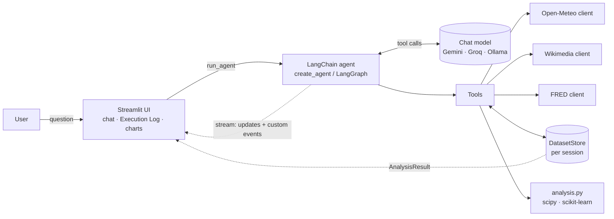
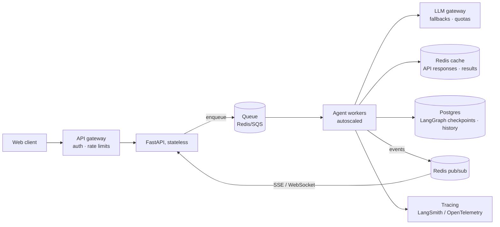

# 📈 Correlation Agent

A proof-of-concept dashboard where you ask a question in plain language, such as *"Do hot days in New York drive interest in ice cream? Forecast next week."*. An LLM agent then:

1. works out what the question means and which variables are involved,
2. **decides on its own** which open-data APIs to call and with which arguments,
3. fetches the data and lines it up on a common time axis,
4. runs statistics and trains small ML models on the fly (Pearson/Spearman correlation, a lag scan, linear regression and a random forest, plus an optional forecast),
5. explains the result in plain language. Interactive charts show the data, and a live **Execution Log** shows every step.

| Data source | What it provides | Key |
|---|---|---|
| [Open-Meteo](https://open-meteo.com) | Daily historical weather (ERA5), air quality & pollen, 16-day forecast for any city | none |
| [Wikimedia Pageviews](https://wikimedia.org/api/rest_v1/) | Daily views of any Wikipedia article in any language, a proxy for public interest | none |
| [FRED](https://fred.stlouisfed.org/docs/api/fred/) | 800k+ US economic/financial series (VIX, CPI, unemployment, rates, prices…) | free, optional |

---

## Quick start

```bash
cp .env.example .env          # add GEMINI_API_KEY and/or GROQ_API_KEY (both free), optionally FRED_API_KEY
```

**Conda**
```bash
conda create -n insdrone python=3.12 -y && conda activate insdrone
pip install -r requirements.txt
streamlit run app.py
```

**venv**
```bash
python3.12 -m venv .venv && source .venv/bin/activate
pip install -r requirements.txt
streamlit run app.py
```

**Docker**
```bash
docker build -t corr-agent .
docker run -p 8501:8501 --env-file .env corr-agent      # → http://localhost:8501
```

**Local LLM instead of Gemini:** install [Ollama](https://ollama.com), run `ollama pull qwen2.5:7b` and choose *Ollama* in the sidebar. Docker reaches the host's Ollama through `host.docker.internal`.

**CLI (no UI):**
```bash
python -m corr_agent.agent "Does snowfall in Innsbruck correlate with interest in skiing?" --provider gemini
```

**Tests:** `pytest`. They cover the API clients with mocked HTTP, the analysis on synthetic data, and the tools with stubbed clients.

### Example questions
- Do hot days in New York drive interest in ice cream? Forecast next week.
- Does grass pollen in Berlin correlate with views of the German article "Heuschnupfen"?
- Is PM2.5 pollution in Delhi related to interest in asthma?
- Does market fear (VIX) drive interest in "Recession"? *(FRED)*
- Is US unemployment correlated with views of "Unemployment benefits"? *(FRED, monthly)*
- Does rain in London affect views of the Bitcoin article? *(should come out close to zero)*

---

## Architecture



```
app.py                     Streamlit UI (chat, live Execution Log, charts)
corr_agent/
  agent.py                 create_agent + streaming → AgentEvent; CLI entry point
  tools.py                 LangChain tools (pydantic schemas) bound to a DatasetStore
  prompts.py               system prompt (procedure for the agent)
  llm.py                   provider factory: Gemini | Groq | Ollama → BaseChatModel
  analysis.py              alignment, correlation, lag scan, regression, forecast (pure, no I/O)
  charts.py                Plotly figures
  data_store.py            per-session datasets addressed by id
  clients/                 plain HTTP clients: open_meteo, wikimedia, fred, shared http (retry + cache)
tests/
```

The code is split into layers, and each layer only knows about the one below it:

- **`clients/`** are plain Python functions that return pandas Series. They don't use LangChain or LLMs, so they are easy to test and reuse.
- **`analysis.py`** is pure, deterministic statistics with no I/O.
- **`tools.py`** is the only place that connects the two to the LLM world.
- **`agent.py`** handles orchestration and event streaming. **`app.py`** only renders.

### Key design choices

**LangChain 1.x `create_agent` (LangGraph under the hood).** The agent is a ReAct-style loop: *model → tool calls → tool results → model → … → final answer*. LangGraph gives us:
- a provider-independent tool-calling interface (`bind_tools`),
- `stream_mode=["updates", "custom"]` for live progress, which powers the Execution Log,
- a recursion limit,
- an easy upgrade path (checkpointers, human-in-the-loop, custom graphs).

I also considered a hand-written loop and LlamaIndex. LlamaIndex's strength is retrieval over documents, which this task doesn't need. A custom loop would be just as small, but switching providers through LangChain's chat-model abstraction takes one line.

**Three LLM providers behind one factory (`llm.py`).** Defaults are small, fast models to stay inside free tiers, and every call is capped at `LLM_MAX_TOKENS`.
- **Gemini** (cloud, free tier, `gemini-3.5-flash-lite`) is the default and handles multi-step tool use well.
- **Groq** (cloud, free tier, `openai/gpt-oss-20b`) gives very fast inference of open-weight models. Groq's catalogue is now mostly reasoning models, so `reasoning_effort="low"` is set: thinking tokens count against both the output cap and the free-tier rate limit.
- **Ollama** (local) runs with no cost and no data leaving the machine. 7–8B models are noticeably less reliable at multi-step tool use, which is why the prompt and tools are built defensively (see below). Use a model that supports tool calling, such as `qwen2.5:7b` or `llama3.1:8b`. Code-tuned variants like `qwen2.5-coder` sometimes print the tool call as text instead of calling it.

**Data by reference, not by value.** Fetch tools store each series in a per-session `DatasetStore` and return only `{dataset_id, label, n_points, start, end, mean, min, max}` to the LLM. The analysis tool takes two dataset ids. This means:
- prompts stay small, since a year of daily data never enters the context,
- the model cannot garble or invent numbers on the way to the analysis,
- the statistics are fully deterministic.

**Frequency alignment.** Weather and pageviews are daily, while FRED series can be business-daily, weekly, monthly or quarterly. Before correlating, both series are averaged to the coarser of the two frequencies (for example, daily views become the average daily views per month) and inner-joined on date.

### How the API integrations and tool calling work

Each tool is a Python function with a **pydantic argument schema**. The schemas use enums for weather and pollutant variables and descriptions for every field. LangChain converts each schema to the provider's function-calling format: a Gemini `FunctionDeclaration` or the OpenAI-style `tools` used by Groq and Ollama. One agent step goes like this:

```
LLM ← system prompt + question + tool JSON schemas
LLM → AIMessage(tool_calls=[{name: "fetch_wikipedia_pageviews", args: {article: "Ice cream", lang: "en"}}])
agent → runs the Python function → ToolMessage('{"dataset_id": "ds2", "n_points": 365, ...}')
LLM ← ToolMessage … (repeat) … → final AIMessage with the explanation
```

| Tool | API |
|---|---|
| `fetch_weather_history` | Open-Meteo geocoding + ERA5 archive (daily) |
| `fetch_air_quality` | Open-Meteo air-quality (hourly → daily mean; pollen in Europe) |
| `fetch_weather_forecast` | Open-Meteo forecast (≤ 16 days), the input for predictions |
| `search_wikipedia_articles` | MediaWiki opensearch |
| `fetch_wikipedia_pageviews` | MediaWiki redirect resolution + Wikimedia REST pageviews |
| `search_fred_series` / `fetch_fred_series` | FRED `series/search`, `series`, `series/observations` (only registered when a key is set) |
| `run_correlation_analysis` | local: `analysis.py` |

Making it robust, especially for small local models:
- **Search before fetch.** The agent looks up exact Wikipedia titles and FRED series ids instead of guessing them.
- **Redirects are resolved automatically.** Pageviews are counted per exact title, so the redirect `de:Heuschnupfen` shows about 2 views a day while its target `Allergische Rhinitis` holds the real traffic.
- **Tools never raise.** Errors come back as `{"error": "..."}` tool results, so the model can fix its arguments and retry, and the Execution Log shows them.
- **Inputs are validated** with clear messages (dates, frequencies, at least 10 overlapping points, constant series, a forecast variable that doesn't match X).
- **A shared HTTP session** sends a descriptive User-Agent (Wikimedia requires one), retries with backoff on 429/5xx, and keeps a 1-hour in-memory response cache.
- **The FRED API key is scrubbed** from any error text before it can reach the LLM or the UI.

### The analysis (`analysis.py`)
- **Pearson r** (linear) and **Spearman ρ** (rank-based, robust to pageview spikes from news events), each with a p-value. The strength label comes from ρ.
- **Lag scan:** Pearson r of `y_t` against `x_{t−k}` for k in [−7, 7]. A lag only counts as "best" if it beats lag 0 by more than 0.05.
- **Linear regression and a random forest**, scored with **out-of-sample R²** using `TimeSeriesSplit`, so the model never trains on the future. A negative R² means the relationship doesn't predict better than the mean.
- **Forecast:** given a weather forecast for X, both models predict Y for the coming days.

---

## Scaling to production

This PoC keeps everything inside one Streamlit process. With heavy traffic I would split it like this:



1. **Separate UI from compute.** Use a React/Next.js (or Streamlit) frontend and a stateless **FastAPI** service behind a load balancer. Agent runs take 5–60 s, so the API **enqueues a job** (Celery/Arq/RQ on Redis, or SQS) and returns a run id. The UI subscribes to the Execution Log over **SSE/WebSocket**. Workers publish the same `AgentEvent`s they stream today through Redis pub/sub.
2. **Horizontal workers.** Agent workers are stateless and autoscale on queue depth (Kubernetes HPA/KEDA). Conversation state moves from `st.session_state` to a **LangGraph checkpointer** (Postgres). `DatasetStore` moves to Redis or object storage (Parquet) keyed by run.
3. **Cache aggressively.** Historical open data is immutable. Cache API responses in **Redis**, keyed by `(source, entity, variable, date range)`, with a long TTL for history and a short one for forecasts. Also cache whole analysis results keyed by the normalized tool-call plan, so popular questions skip both the APIs and the model. A nightly job can pre-warm popular series into a columnar store such as DuckDB/Parquet or TimescaleDB.
4. **Respect upstream limits.** Use per-API token-bucket rate limiters shared across workers in Redis, circuit breakers, and retry with jittered backoff. For real volume, use Open-Meteo's commercial or self-hosted option, the Wikimedia bulk dumps, and FRED key rotation. Merge identical in-flight requests so they hit the API only once.
5. **LLM layer.** Route requests through an LLM gateway with quotas, `with_fallbacks()` across providers (for example Gemini → hosted open model), and model tiering: a cheap model for planning and tool calls, a stronger one only for the final explanation. Use prompt caching for the static system prompt and tool schemas. Self-hosted models would run on vLLM rather than Ollama.
6. **Safety and quality.** Set per-user cost and step budgets (the agent's recursion limit is a first version of this; LangChain's `ToolCallLimitMiddleware` would add per-tool caps), validate tool arguments, and keep an evaluation set of questions with expected tool plans, run in CI.
7. **Observability.** Use LangSmith or OpenTelemetry traces for every LLM and tool call, metrics (latency, tokens, cost, tool error rate, cache hit rate), and structured logs.

---

## Limitations and honest caveats
- **Correlation is not causation.** Many strong results here, such as temperature vs. "Ice cream", come largely from **shared seasonality**. The agent is instructed to say so. A natural next step would be to also correlate detrended or differenced series.
- **Data coverage.** English Wikipedia is read worldwide, so local questions work better with a local-language edition. Pollen data covers only Europe. FRED is mostly US data. ERA5 weather lags real time by about 5 days.
- **Small local models** sometimes skip steps or stop early. Gemini is the more reliable default.
